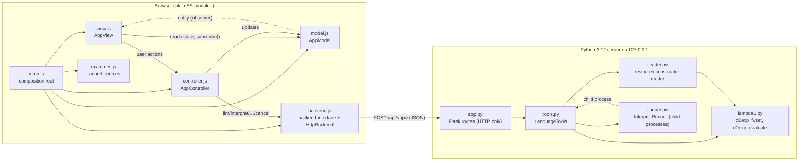
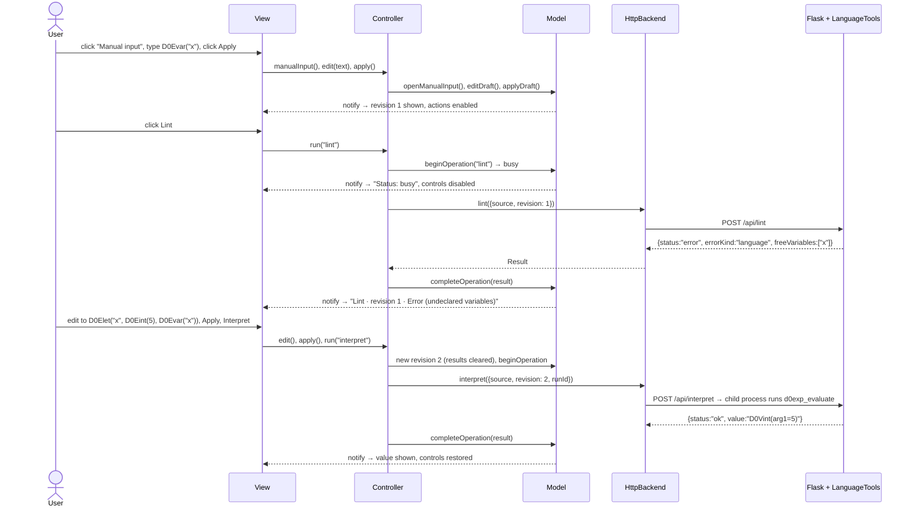

# Architecture

The application is a local, single-user web front-end for LAMBDA. It follows
the classic Model–View–Controller pattern in the browser. A Python server
sits behind a backend interface and provides the language tools from
`lambda1.py`.

* **Model** (`web/js/model.js`) owns all application state and its rules,
  and notifies subscribers when anything changes.
* **View** (`web/js/view.js`) subscribes to the Model and redraws from it. It
  forwards user actions to the Controller and never changes the Model itself.
* **Controller** (`web/js/controller.js`) is the only code that changes the
  Model. It also calls the backend.
* **Backend adapter**: `web/js/backend.js` defines the interface and its HTTP
  implementation. `server/app.py` translates HTTP to Python calls, and
  `server/tools.py` is the only Python code that touches `lambda1.py`.

## Component diagram

The arrows mean "depends on" or "calls". Each box is an actual module.



The Model imports nothing. The View imports only constants from the Model.
The Controller does not import the View. Only `main.js` knows which concrete
backend is used, so the tests can swap in a fake backend.

## Responsibility table

| Role | Implementation | Responsibilities |
| --- | --- | --- |
| Model | `web/js/model.js` → `AppModel`, `sourceProblem` | Applied source `{name, text, revision}`, the editor draft, the busy operation, results, the generated-code artifact, notices and the retry offer. `clearResults()` removes results and the retry offer only. Rules: reject empty or over-1 MB source and keep both the applied source and the rejected draft; every accepted change gets a new revision and clears results and the artifact; no replacing source or running tools while there are unapplied edits or something is running; Execute only with an artifact for the current revision; ignore stale results. `subscribe()` notifies observers. No DOM, no fetch. |
| View | `web/index.html`, `web/style.css`, `web/js/view.js` → `AppView` | Renders the Load source menu, editor, the five actions in order, Stop, Retry and Clear results, a text status, notices and results. Uses `textContent` and `.value` only, so source and output stay literal. Forwards events to the Controller. No language logic. |
| Controller | `web/js/controller.js` → `AppController` | Load source menu actions (UTF-8 decoding of uploads, canned examples, manual input), editing, Apply and Discard, `run(op)`, `stop()`, `retry()`, `clearResults()`. Builds requests from the Model, calls the backend, turns exceptions into failure results, and passes results to the Model. |
| Backend interface | `web/js/backend.js` → `HttpBackend`, `makeResult` | The interface the Controller calls: `lint`, `interpret`, `typecheck`, `compile`, `execute`, `cancel`. `HttpBackend` maps them to `POST /api/<op>` and turns network and server errors into failure results. |
| HTTP layer | `server/app.py` → `create_app` | Serves `web/`, validates JSON requests and calls `LanguageTools`. Bad requests return failure results with HTTP 400; unexpected exceptions return failure results with HTTP 500. Holds no state. |
| Language tools | `server/tools.py` → `LanguageTools`, `lint_source`, `evaluate_source` | Real Lint (`d0exp_fvset`) and Interpret (`d0exp_evaluate`, with detection of the `D0V000` sentinel), the placeholders, and the Execute contract. |
| Input reader | `server/reader.py` → `read_d0exp` | Parses the source with `ast` and checks it against an allow-list of the `D0E*` constructors and literals. Never runs `eval`. |
| Execution control | `server/runner.py` → `InterpretRunner` | Runs Interpret in a child process that `cancel(run_id)` can kill. |

## Backend contract

Conceptual operations (`backend.js` documents the same contract):

```text
lint({source, revision})              -> Result
interpret({source, revision, runId})  -> Result        (stoppable)
typecheck({source, revision})         -> Result status "not_implemented"
compile({source, revision})           -> Result status "not_implemented"
execute({artifact, revision})         -> Result        (needs an artifact)
cancel({runId})                       -> stop a running interpret
```

Every result carries its operation and the source revision it was computed
for:

```json
{ "op": "interpret", "revision": 3, "status": "error",
  "errorKind": "runtime", "message": "Runtime error: ZeroDivisionError: ...",
  "value": null, "details": {} }
```

| `status` | Meaning | `errorKind` |
| --- | --- | --- |
| `ok` | The operation succeeded. `value` holds the interpreted value, e.g. `D0Vint(arg1=42)`. | `null` |
| `error` | The user's program is the problem. | `input`: not a valid constructor expression, empty, or too large. `language`: Lint found undeclared variables, listed in `details.freeVariables` in sorted order. `runtime`: evaluation raised an error or produced `D0V000()`, directly or inside a pair. |
| `failure` | The tools broke: bad request, server exception, crashed child process, or server unreachable. The source is kept and Retry is offered. | `backend` |
| `not_implemented` | Type-check and Compile placeholders. Never counted as success. | `null` |
| `cancelled` | The user pressed Stop. | `null` |

HTTP mapping: `POST /api/lint|interpret|typecheck|compile|execute` with the
JSON fields above, and `POST /api/cancel {runId}`. Program errors are still
HTTP 200, because the request itself succeeded.

## Trace: Load source → Lint → Interpret



The same steps in words:

1. **Load source.** The user picks Manual input (or a canned example, or a
   file). The View calls `controller.manualInput()`, and the Model opens a
   blank draft. Typing calls `controller.edit(text)` and updates the draft,
   so the Model now has unapplied edits and every tool button is disabled.
2. **Apply.** `controller.apply()` → `model.applyDraft()`. The Model checks
   that the text is not empty and is under 1 MB, then creates revision 1,
   clears results and the artifact, and notifies. The View re-renders and
   shows "Applied source: Manual input — revision 1".
3. **Lint.** `controller.run("lint")` → `model.beginOperation` sets the
   busy state, and the View disables the controls and shows "Status: busy".
   The Controller sends `backend.lint({source, revision: 1})`. On the server,
   `read_d0exp` builds the `D0Evar("x")` object and `d0exp_fvset` returns
   `frozenset({"x"})`. Nothing is evaluated.
4. **Undeclared variable.** The result is `status: "error"`,
   `errorKind: "language"`, message `Undeclared variable(s): x`.
   `model.completeOperation` checks that the operation and revision match
   what is running, stores the result and clears the busy state. The View
   shows "Lint · revision 1 · Error (undeclared variables)".
5. **Fix and Interpret.** The user edits the program into a closed one and
   applies it, which creates revision 2 and clears the old Lint result. The
   user clicks Interpret. `InterpretRunner` starts a child process that runs
   `d0exp_evaluate(e, ENVnil())`, and the result
   `ok / D0Vint(arg1=5)` comes back the same way as in step 4.
   * If Interpret had been run on `D0Evar("x")` instead, evaluation returns
     the `D0V000()` sentinel, which is reported as a runtime error. This is
     why Lint and Interpret are separate actions.
   * If the program never terminates, Stop calls `controller.stop()` →
     `backend.cancel({runId})`. The server kills the child process, and the
     pending request finishes with `status: "cancelled"`.

## Design decisions

**1. MVC lives in the browser; the server is a stateless tool adapter.**
The Model, View and Controller are plain JavaScript modules. The Python
server only answers language-tool requests, which is a direct fit for the
classic observer-based MVC, where the View subscribes to the Model and
redraws when it changes. It also means the Model and Controller can be
tested in Node without a browser or server, and the Controller can be given a
fake backend without touching the View.
*Tradeoff:* the state rules live in JavaScript while the tools live in
Python, so a few facts are duplicated. The 1 MB limit is defined in both
`model.js` and `reader.py`, and the server re-checks it rather than trusting
the client. State is also lost when the page is reloaded, which the
assignment allows.

**2. The Controller coordinates the backend; the Model stays pure.**
The Model never performs input or output. It only accepts or refuses state
changes such as `beginOperation` and `completeOperation`, and drops results
whose operation or revision does not match. Asynchronous calls, run ids and
error conversion are all in the Controller.
*Tradeoff:* the Controller has to call the Model in the right order, and
the Model has to defend itself against stale results or calls made in the
wrong order.

**3. Interpret runs in a killable process; the user decides when to stop.**
Python threads cannot be stopped from outside, so each Interpret runs in a
`multiprocessing` child process (spawn start method). Stop sends
`/api/cancel`, which kills the process. The browser also aborts its pending
request, so the UI recovers even if the server hangs. There is no fixed
timeout: a long but legitimate computation is not cut off, and a
non-terminating one can never leave the app permanently busy. The child
raises Python's recursion and integer-printing limits, so deep programs such
as `fact(5000)` work.
*Tradeoff:* starting a process costs about 0.1–0.5 s per Interpret, and
deliberately looping programs run until the user presses Stop.

## Replacing the placeholders

**Type-check.** Implement `LanguageTools.typecheck` in `tools.py`: read the
source with `read_d0exp`, run a checker that returns the program's type or
type errors, and return `ok` or `error` with `errorKind: "language"`. Nothing
in the browser changes, because the button, dispatch and result rendering
already exist.

**Compile and the artifact contract.** A compiler would return
`status: "ok"` together with

```json
"details": { "artifact": { "revision": 3, "format": "<target>", "code": "..." } }
```

`AppModel.completeOperation` stores `details.artifact` only when it comes
from a successful Compile for the current revision. Execute is enabled only
while `artifact.revision === applied.revision`. Every new revision sets the
artifact back to `null`, so a source change or a failed recompilation
disables Execute again.

**Execute.** The Controller sends
`execute({artifact, revision})`, which uses the stored artifact rather than
the source text. `LanguageTools.execute` already rejects a missing artifact
or one from a different revision. A real implementation would run
`artifact.code` with the target's runtime, in a child process like
`InterpretRunner` so Stop works too, and return its output as `value`.
Execute never recompiles silently and never falls back to Interpret.
None of this exists yet; Execute is disabled and explains why.
