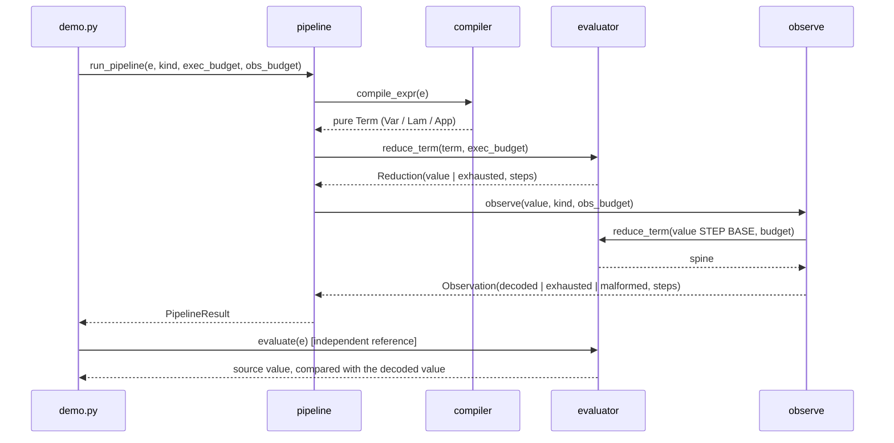
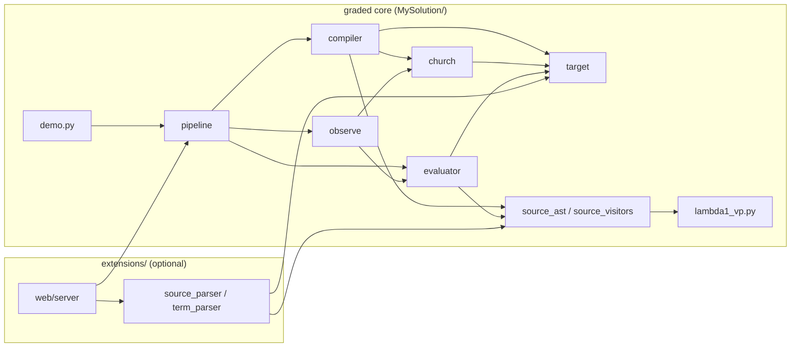
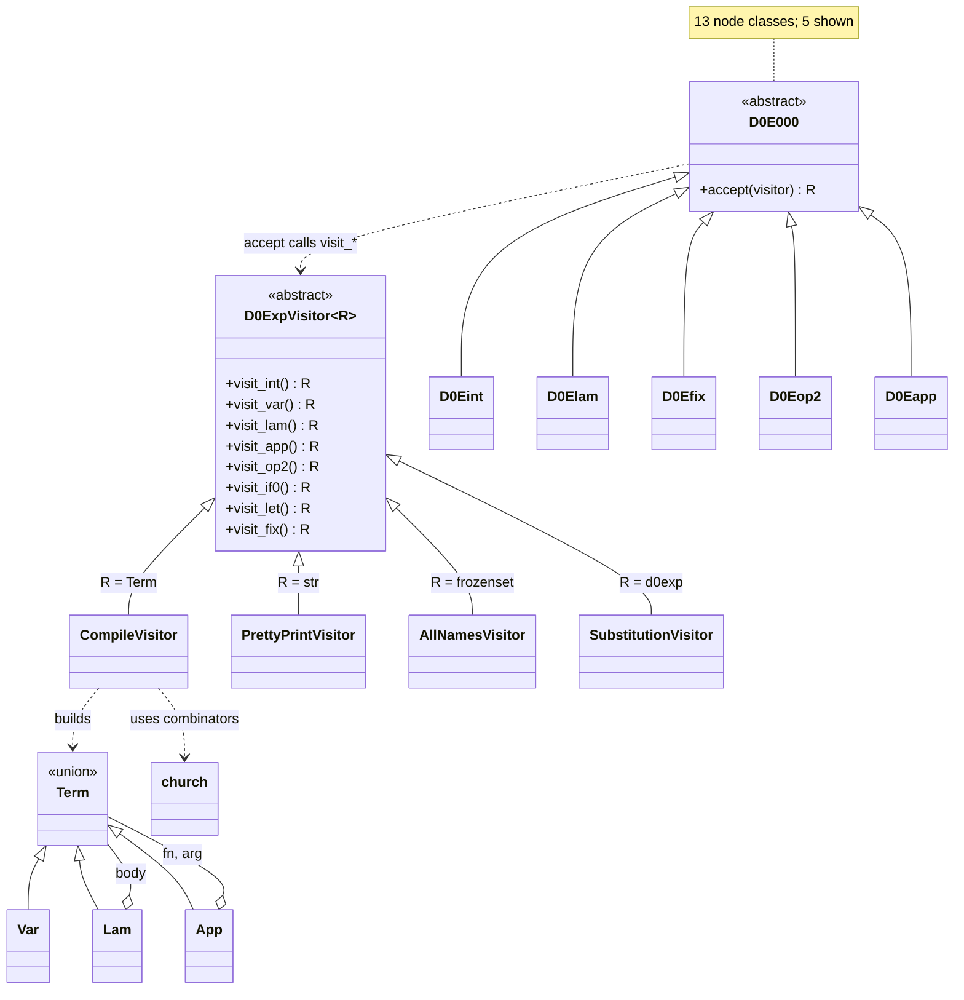

# Design: Compiling Extended LAMBDA into Pure Lambda-Calculus

## Architecture

The system is a three-stage pipeline over immutable data: compile, execute,
observe. Each stage is a function from one data format to the next, and the
stages share no state. `pipeline.py` is the only module that connects them,
and both the demo and the web front-end use it. The source evaluator runs
beside the pipeline as an independent reference. It never runs inside it.



The arrows in the package diagram show imports, and every arrow points one
way. `test_modules.py` enforces this. The compiler cannot evaluate, so it
cannot compute an answer and encode it. The evaluator cannot see the
encoding library, so it cannot replace a numeral's reduction with Python
arithmetic. The extensions depend on the core, and the core never depends on
them.



The compiler is a Visitor over the supplied AST, which must not be modified.
Every source-side operation is its own `D0ExpVisitor`. The target AST
belongs to us and has only three node types, so its operations use `match`
instead of visitor classes. Its nodes are frozen, so terms cannot be mutated
and each node can safely cache its free variables.



The evaluator is an abstract machine. It loops over the current term with an
explicit stack of continuation frames. Python does not optimize tail calls,
so a recursive evaluator would use one Python stack frame per beta step and
crash long before a 100,000-step budget ran out.

## Target language and reduction

`Term ::= Var | Lam | App`, printed as `x`, `(lam x. body)` and `(fn arg)`.
The shared evaluator uses weak, left-to-right call-by-value, and lambdas are
its values. An application evaluates the function, then the argument, then
performs one beta-value step `(lam x. body) v --> body[x := v]`. Substitution
is capture-avoiding and renames only binders that would capture. The reducer
only ever substitutes closed values, so in practice it never renames. There
is no reduction under lambdas and no eta reduction.

A budget limits the number of beta-value steps. A value completes in zero
steps, even with budget zero, and a value reached on the last allowed step
counts as completed. On exhaustion, the evaluator rebuilds the residual
program from its frames. Open programs are rejected before the first step.

Source ASTs run in the same loop. Variables, lambdas and applications share
the target's branches, and each source-only constructor pushes its own frame.

## Church encodings

```text
TRUE   = lam t. lam f. t            FALSE = lam t. lam f. f
NUM(n) = lam s. lam z. s^n z        PAIR  = lam a. lam b. lam p. p a b
FST    = lam p. p TRUE              SND   = lam p. p FALSE
NOT    = lam b. b FALSE TRUE        AND   = lam p. lam q. p q FALSE      OR = lam p. lam q. p TRUE q
SUCC   = lam n. lam s. lam z. s (n s z)
ISZERO = lam n. n (lam x. FALSE) TRUE
ADD    = lam m. lam n. lam s. lam z. m s (n s z)
MUL    = lam m. lam n. lam s. m (n s)
SHIFT  = lam p. PAIR (SND p) (SUCC (SND p))
PRED   = lam n. FST (n SHIFT (PAIR NUM(0) NUM(0)))
SUB    = lam m. lam n. n PRED m
LEQ    = lam m. lam n. ISZERO (SUB m n)
GEQ m n = LEQ n m     LT m n = NOT (LEQ n m)     GT m n = NOT (LEQ m n)
EQ m n  = AND (LEQ m n) (LEQ n m)                NEQ m n = NOT (EQ m n)
Z      = lam g. (lam x. g (lam v. x x v)) (lam x. g (lam v. x x v))
I      = lam w. w
```

The names are abbreviations. In the output, each is written out as its full
closed pure term.

**Predecessor.** A numeral can apply a function n times, but not n − 1
times, so the construction keeps a sliding pair. `SHIFT` maps `(a, b)` to
`(b, b + 1)`. Starting from `(0, 0)`, n shifts give `(n − 1, n)`, and `FST`
takes the predecessor. For n = 0 nothing is applied, so `PRED 0 = 0` without
a special case. `SUB m n` applies `PRED` n times to m, so subtraction stops
at zero. Every comparison then reduces to `m ≤ n ⟺ m − n = 0`.

## Translation rules

```text
C[n]                    = NUM(n)                          (n >= 0)
C[true]                 = TRUE
C[false]                = FALSE
C[x]                    = x
C[lam x. e]             = lam x. C[e]
C[e1 e2]                = C[e1] C[e2]
C[not e]                = NOT C[e]
C[e1 + e2]              = ADD C[e1] C[e2]
C[e1 - e2]              = SUB C[e1] C[e2]
C[e1 * e2]              = MUL C[e1] C[e2]
C[e1 < e2]              = LT  C[e1] C[e2]
C[e1 <= e2]             = LEQ C[e1] C[e2]
C[e1 > e2]              = GT  C[e1] C[e2]
C[e1 >= e2]             = GEQ C[e1] C[e2]
C[e1 == e2]             = EQ  C[e1] C[e2]
C[e1 != e2]             = NEQ C[e1] C[e2]
C[e1 and e2]            = (C[e1] (lam u. C[e2]) (lam v. FALSE)) I
C[e1 or e2]             = (C[e1] (lam u. TRUE) (lam v. C[e2])) I
C[if c then t else f]   = (C[c] (lam u. C[t]) (lam v. C[f])) I
C[let x = e1 in e2]     = (lam x. C[e2]) C[e1]
C[pair e1 e2]           = PAIR C[e1] C[e2]
C[fst e]                = FST C[e]
C[snd e]                = SND C[e]
C[fix f(x). e]          = Z (lam f. lam x. C[e])
```

Each rule combines only the translations of the node's children. Nothing is
evaluated during compilation, so diverging programs compile normally. Every
node is visited, so `CompileError` is raised for a negative literal or an
unsupported operator anywhere in the program, including in branches that
would never run. Under call-by-value, `OP C[e1] C[e2]` evaluates `C[e1]` and
then `C[e2]`, which preserves the left-to-right order of operands and pair
components.

## Fresh-name policy

Source binders keep their own names, so lexical scope carries over
unchanged. `fix f(f). e` becomes `Z (lam f. lam f. C[e])`, where the inner
binder (the parameter) wins, as the source requires. The only binders the
compiler introduces around translated code are the thunk parameters. For
`lam p. T`, `p` is the first of `u_1, u_2, …` (or `v_1, …`) that occurs
nowhere in `T`, free or bound. The choice depends only on `T`, so it is
deterministic, and the unused parameter cannot capture. No source name is
reserved. The combinators are closed and only ever applied, never wrapped
around source code, so their internal names cannot capture. Hence
`FV(C[e]) = FV(e)`.

## Observation

A result can still hold unreduced redexes inside its lambdas, so the
decoders never compare it with a normal form. Each decoder applies the value
to a pure context and runs it with the same reducer, under a separate
observation budget.

```text
natural:  v STEP BASE      STEP = lam tail. lam c. lam z. c tail     BASE = lam c. lam z. z
boolean:  v MARK_T MARK_F  MARK_T = lam p. lam q. lam r. p           MARK_F = lam p. lam q. lam r. q
pair:     FST v and SND v evaluated, then each observed with its component's kind
```

Python counts the spine's nodes up to alpha-renaming, or checks which marker
came back. Applying a marker to anything leaves a two-binder term, so a value
that misuses a marker is reported as malformed rather than accidentally
matching the other marker. Python never performs the arithmetic. The caller
states the expected kind, because `NUM(0)` and `FALSE` are the same term.

## Correctness

**Claim.** For closed, well-typed programs in the call-by-value source
language that produce natural, boolean, or finite data-pair results,
observing the corresponding compiled result yields the same data, given
sufficient reduction resources. A diverging source program yields no
compiled value.

**Argument.** The argument goes by induction on the program, showing that
each construct takes the same evaluation steps in both languages.

- *Application.* Both languages evaluate the function, then the argument,
  then substitute. Translation commutes with substitution of values,
  `C[e[x := v]] = C[e][x := C[v]]`, because source binders keep their names
  and thunk parameters are fresh. So each source beta step corresponds to a
  target beta step.
- *Conditional.* `C[c]` reduces to `TRUE` or `FALSE`. The branches are
  lambdas, so passing them runs neither one. The boolean selects one thunk,
  and applying it to `I` runs only that branch. `and`/`or` reuse this
  mechanism, so they short-circuit.
- *Let.* `(lam x. C[e2]) C[e1]` evaluates `C[e1]` first, even when `x` is
  unused, and then substitutes it. That matches the source rule, and `x` is
  unbound in `C[e1]`, as the initializer's scope requires.
- *Recursion.* `Z G` with `G = lam f. lam x. C[e]` reaches
  `lam x. C[e][f := lam v. Z′ v]` in a few steps. The recursive reference is
  an eta-expanded value, and each call unfolds it exactly once, as source
  `fix` does.
- *Operators and values.* Literals and lambdas translate to values. Each
  combinator computes its operation on encoded values, which the per-encoding
  tests confirm.

**Why delayed branches and call-by-value recursion matter.** Call-by-value
evaluates every argument before the call. An `if` encoded as `C[c] C[t] C[f]`
would run both branches, so `if true then 1 else LOOP` would diverge and no
recursion could terminate. A lambda around each branch suspends it. That
relies on lambdas being values, which is why the reducer never reduces
under lambdas or eta-reduces: `lam v. x x v` is a value, while `x x` may
diverge. Ordinary `Y` places `x x` in an argument position, so `Y g` unfolds
forever. `Z` eta-expands that self-application, and recursion unfolds only
on demand.

**Why testing is not a proof.** The suite checks finitely many programs: the
demonstrations, hand-written cases, and 500 seeded random programs compared
against the source evaluator. Passing means only that no counterexample was
found among them. Both paths share substitution code, so a shared bug could
go unnoticed, and budget exhaustion never proves divergence. A proof would
need the substitution lemma above and a simulation argument for every
evaluation step. Planting scope bugs showed that the tests detect such
errors, but that increases confidence. It does not establish correctness.

## Design tradeoffs

- **One machine for both languages** guarantees the same strategy in both,
  at the cost of a larger evaluator with a frame type per source form.
  Import rules and a test that makes source operations fail keep the target
  path pure.
- **Substitution rather than environments** matches the specified
  beta-value rule step for step and makes the residual program printable.
  Closures would be faster, but step counts would no longer correspond to
  the specified steps.
- **Unary numerals** are simple, but their cost grows with the values:
  `fib 5` takes 2,021 steps. That is why the default budgets are a generous
  100,000.
- **Visitor for the source, `match` for the target.** The Visitor pattern
  pays off on a fixed 13-class AST. On our three-class AST, `match` is
  shorter.
- **Separate execution and observation budgets** show how much work stays
  deferred inside result lambdas. `2 + 3 * 4` needs 4 execution steps and 25
  observation steps.
